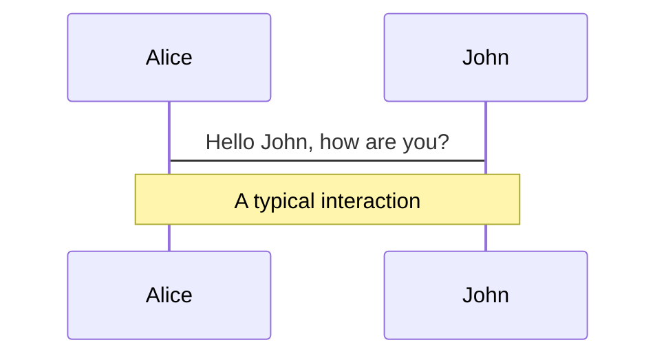
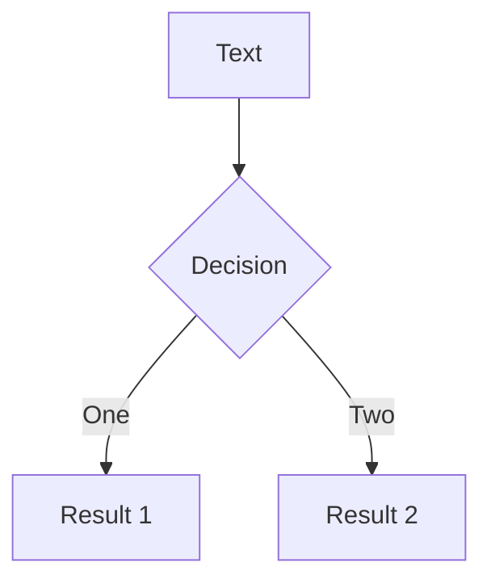

# Cú pháp Markdown

Các slide được viết trong **một file markdown duy nhất** (mặc định là `./slides.md`).

Bạn có thể sử dụng [các tính năng Markdown](https://github.com/adam-p/markdown-here/wiki/Markdown-Cheatsheet) như bình thường, kèm theo hỗ trợ thêm của HTML inline và các component Vue. Việc tạo style bằng [UnoCSS](/custom/config-unocss) cũng được hỗ trợ. Dùng `---` kèm dòng trống để phân tách các slide.

````md
# Slidev

Hello, World!

---

# Page 2

Directly use code blocks for highlighting

```ts
console.log('Hello, World!')
```

---

# Page 3

You can directly use Windi CSS and Vue components to style and enrich your slides.

<div class="p-3">
  <Tweet id="20" />
</div>
````

## Frontmatter & Layout

Chỉ định layout và các metadata khác cho từng slide bằng cách chuyển các dấu phân cách thành các [block frontmatter](https://jekyllrb.com/docs/front-matter/). Mỗi frontmatter bắt đầu bằng ba dấu gạch ngang và kết thúc bằng ba dấu gạch ngang khác. Văn bản nằm giữa là các đối tượng dữ liệu theo định dạng [YAML](https://www.cloudbees.com/blog/yaml-tutorial-everything-you-need-get-started/). Ví dụ:

<!-- eslint-skip -->

```md
---
layout: cover
---

# Slidev

This is the cover page.

---
layout: center
background: /background-1.png
class: 'text-white'
---

# Page 2

This is a page with the layout `center` and a background image.

---

# Page 3

This is a default page without any additional metadata.
```

Tham khảo [tùy chỉnh](/custom/) để biết thêm chi tiết.

### Hỗ trợ Prettier

> Có từ phiên bản v0.44

Cú pháp tùy chỉnh có thể không tương thích với một số công cụ định dạng như Prettier.  
Bạn có thể cài đặt [Plugin Prettier](/guide/editors#prettier-plugin) hoặc sử dụng trực tiếp block code `yaml` để định nghĩa frontmatter thay thế:

````md
---
layout: cover
---

# Slidev

This is the cover page.

---

```yaml
# The first yaml block will be treated as the frontmatter of that slide
layout: center
background: /background-1.png
class: 'text-white'
```

# Page 2

This is a page with the layout `center` and a background image.
````

## Khối code

Một lý do lớn dẫn đến việc tạo ra Slidev là nhu cầu hiển thị code hoàn hảo trong các slide. Do đó, bạn có thể sử dụng các khối code theo chuẩn Markdown để làm nổi bật code của mình.

````md
```ts
console.log('Hello, World!')
```
````

Slidev tích hợp sẵn [Shiki](https://github.com/shikijs/shiki) làm công cụ tô màu cú pháp. Tham khảo thêm ở phần [highlighters](/custom/highlighters) để biết chi tiết.

### Đánh dấu dòng

Để đánh dấu các dòng cụ thể, chỉ cần thêm số dòng trong dấu ngoặc nhọn `{}`. Số dòng bắt đầu đếm từ 1 theo mặc định.

````md
```ts {2,3}
function add(
  a: Ref<number> | number,
  b: Ref<number> | number
) {
  return computed(() => unref(a) + unref(b))
}
```
````

Để thay đổi phần được đánh dấu qua nhiều lần nhấp, bạn có thể dùng `|` để phân tách từng bước:

````md
```ts {2-3|5|all}
function add(
  a: Ref<number> | number,
  b: Ref<number> | number
) {
  return computed(() => unref(a) + unref(b))
}
```
````

Điều này sẽ lần lượt làm nổi bật `a: Ref<number> | number` và `b: Ref<number> | number`, sau đó là `return computed(() => unref(a) + unref(b))` sau một lần nhấp, và cuối cùng là toàn bộ khối code.

Bạn có thể đặt số dòng thành `hide` để ẩn khối code hoặc `none` để không làm nổi bật dòng nào:

````md
```ts {hide|none}
function add(
  a: Ref<number> | number,
  b: Ref<number> | number
) {
  return computed(() => unref(a) + unref(b))
}
```
````

::: tip
Tìm hiểu thêm trong [hướng dẫn hiệu ứng nhấp chuột](./animations#positioning).
:::

### Đánh số dòng

Bạn có thể bật đánh số dòng cho tất cả các slide bằng cách đặt `lineNumbers: true` trong cấu hình toàn cục hoặc bật cho từng khối code riêng lẻ bằng cách đặt `lines: true`. Bạn cũng có thể đặt số dòng bắt đầu cho mỗi khối code và làm nổi bật các dòng tương ứng; mặc định là 1:

````md
```ts {6,7}{lines:true,startLine:5}
function add(
  a: Ref<number> | number,
  b: Ref<number> | number
) {
  return computed(() => unref(a) + unref(b))
}
```
````

### Chiều cao tối đa

Nếu code không vừa trong một slide, bạn có thể sử dụng `maxHeight` để đặt chiều cao cố định và bật cuộn:

````md
```ts {2|3|7|12}{maxHeight:'100px'}
function add(
  a: Ref<number> | number,
  b: Ref<number> | number
) {
  return computed(() => unref(a) + unref(b))
}
/// ...as many lines as you want
const c = add(1, 2)
```
````

### Tích hợp TwoSlash

> Có từ phiên bản v0.46

Tính năng này chỉ có khi bạn [đặt `highlighter` thành `shiki`](/custom/highlighters)

[TwoSlash](https://twoslash.netlify.app/) là một công cụ mạnh mẽ để hiển thị các đoạn code TypeScript với thông tin style khi rê chuột hoặc nhúng trực tiếp. Nó rất hữu ích khi chuẩn bị slide cho các chủ đề liên quan đến JavaScript/TypeScript.

Để sử dụng, bạn có thể thêm `twoslash` vào định danh ngôn ngữ của đoạn code:

````md
```ts twoslash
import { ref } from 'vue'

const count = ref(0)
//            ^?
```
````

Nó sẽ được hiển thị như sau:

```ts twoslash
import { ref } from 'vue'

const count = ref(0)
//            ^?
```

<!-- For the popup to not to overlap the content below -->
<div class="py-20" />

### Shiki Magic Move

> Có từ phiên bản v0.48

[Shiki Magic Move](https://github.com/shikijs/shiki-magic-move) cho phép bạn có các chuyển tiếp chi tiết giữa các thay đổi code, tương tự như Magic Move của Keynote. Bạn có thể kiểm tra [playground](https://shiki-magic-move.netlify.app/) để xem cách hoạt động.

<video src="https://github.com/slidevjs/slidev/assets/11247099/79927794-27ba-4342-9911-9996cec889d6" controls rounded shadow w-full></video>

Trong Slidev, chúng tôi liên kết magic-move với [hệ thống click](/guide/animations#click-animations). Cú pháp là bao bọc nhiều block code đại diện cho mỗi bước với <code>````md magic-move</code> (lưu ý là **4** dấu backtick), điều này sẽ biến thành một block code duy nhất, chuyển đổi theo từng bước khi bạn click.

`````md
````md magic-move
```js
console.log(`Step ${1}`)
```
```js
console.log(`Step ${1 + 1}`)
```
```ts
console.log(`Step ${3}` as string)
```
````
`````

Bạn cũng có thể kết hợp Magic Move với [đánh dấu dòng](#line-highlighting) và [số dòng](#line-numbers), ví dụ:

`````md
````md magic-move {at:4, lines: true} // [!code hl]
```js {*|1|2-5} // [!code hl]
let count = 1
function add() {
  count++
}
```

Các khối không phải code ở giữa sẽ bị bỏ qua, bạn có thể chèn một số chú thích.

```js {*}{lines: false} // [!code hl]
let count = 1
const add = () => count += 1
```
````
`````

<!-- TODO: add an inline demo -->

### Monaco Editor

Bất cứ khi nào bạn muốn chỉnh sửa trong bài thuyết trình, chỉ cần thêm `{monaco}` sau định danh ngôn ngữ — nó sẽ biến khối đó thành một trình chỉnh sửa Monaco đầy đủ tính năng!

````md
```ts {monaco}
console.log('HelloWorld')
```
````

Tìm hiểu thêm về [cấu hình Monaco](/custom/config-monaco).

#### Monaco Diff

Monaco cũng có thể tạo sự khác biệt giữa hai khối code. Sử dụng `{monaco-diff}` để biến khối đó thành một [trình so sánh Monaco](https://microsoft.github.io/monaco-editor/playground.html?source=v0.36.1#example-creating-the-diffeditor-multi-line-example) và dùng `~~~` để phân tách phiên bản gốc và phiên bản đã chỉnh sửa của code!

````md
```ts {monaco-diff}
This line is removed on the right.
just some text
abcd
efgh
Some more text
~~~
just some text
abcz
zzzzefgh
Some more text.
This line is removed on the left.
```
````

Nó cung cấp trình soạn thảo với nút "Run" và hiển thị kết quả thực thi code ngay bên dưới khối code. Bạn cũng có thể chỉnh sửa code và kết quả sẽ được đánh giá lại ngay lập tức.

Mặc định, code sẽ tự động chạy khi slide được tải; nếu bạn muốn kích hoạt chạy code một cách thủ công, bạn có thể đặt `{autorun:false}`.

````md
```ts {monaco-run} {autorun:false}
console.log('Click the play button to run me')
```
````

Nếu bạn chỉ muốn hiển thị kết quả ở một số lần nhấp nhất định, bạn có thể sử dụng thuộc tính `showOutputAt`. Giá trị của nó giống như `v-click`.

````md
```ts {monaco-run} {showOutputAt:'+1'}
console.log('Shown after 1 click')
```
````

Hiện tại Slidev hỗ trợ chạy code JavaScript và TypeScript ngay khi cài đặt. Tham khảo [Custom Code Runners](/custom/config-code-runners) để hỗ trợ ngôn ngữ tùy chỉnh.

#### Monaco Editor có thể chỉnh sửa

> Có từ phiên bản v0.49.5

Bạn cũng có thể sử dụng cú pháp [Import Code Snippets](#import-code-snippets) kết hợp với chỉ thị `{monaco-write}`, để liên kết Monaco Editor với một file trên hệ thống tập tin của bạn. Điều này cho phép bạn chỉnh sửa code trực tiếp trong trình soạn thảo và lưu các thay đổi trở lại file.

```md
<<< ./some-file.ts {monaco-write}
```

Khi sử dụng tính năng này, hãy chắc chắn sao lưu các file của bạn trước, vì các thay đổi sẽ được lưu trực tiếp vào file.

## Style Nhúng

Bạn có thể sử dụng thẻ `<style>` trong Markdown của mình trực tiếp để ghi đè các style cho **slide hiện tại**.

```md
# This is Red

<style>
h1 {
  color: red
}
</style>

---

# Next slide is not affected
```

Thẻ `<style>` trong Markdown luôn được [phạm vi hóa (scoped)](https://vuejs.org/api/sfc-css-features.html#scoped-css). Do đó, bộ chọn có bộ kết hợp con (`.a > .b`) sẽ không sử dụng được như vậy; xem liên kết trước đó. Để có các ghi đè style toàn cục, hãy tham khảo [phần tùy chỉnh](/custom/directory-structure#style).

Được hỗ trợ bởi [UnoCSS](/custom/config-unocss), bạn có thể sử dụng trực tiếp CSS lồng nhau và [chỉ thị](https://unocss.dev/transformers/directives) (ví dụ `--uno:` hoặc `@apply`)

```md
# Slidev

> Hello `world`

<style>
blockquote {
  code {
    --uno: text-teal-500 dark:text-teal-400;
  }
}
</style>
```

## Tài sản tĩnh

Giống như trong markdown, bạn có thể sử dụng hình ảnh trỏ tới URL từ xa hoặc cục bộ.

Đối với tài sản từ xa, plugin tích hợp sẵn [`vite-plugin-remote-assets`](https://github.com/antfu/vite-plugin-remote-assets) sẽ lưu cache chúng vào đĩa trong lần chạy đầu tiên, đảm bảo tải nhanh ngay cả với các hình ảnh lớn về sau.

```md

```

Đối với tài sản cục bộ, hãy đặt chúng vào [`thư mục public`](/custom/directory-structure.html#public) và tham chiếu chúng với **dấu gạch chéo dẫn đầu**.

```md

```

Nếu bạn muốn áp dụng kích thước hoặc style dáng tùy chỉnh, bạn có thể chuyển chúng thành thẻ ``.

```html

```

## Ghi chú

Bạn cũng có thể tạo ghi chú cho người trình bày cho mỗi slide. Chúng sẽ hiển thị trong [Chế độ trình bày](/guide/presenter-mode) để bạn tham khảo khi thuyết trình.

Trong Markdown, khối chú thích cuối cùng trong mỗi slide sẽ được xem như một ghi chú.

```md
---
layout: cover
---

# Page 1

This is the cover page.

<!-- This is a note -->

---

# Page 2

<!-- This is NOT a note because it precedes the content of the slide -->

The second page

<!--
This is another note
-->
```

Markdown và HTML cơ bản cũng được hỗ trợ trong ghi chú khi Presenter hiển thị nội dung ghi chú.

### Đánh dấu Click

> Có từ phiên bản v0.48

Đối với một số slide, bạn có thể có ghi chú dài và khó để theo dõi chỗ của mình. Slidev hỗ trợ đánh dấu click cho phép làm nổi bật và tự động cuộn đến phần ghi chú tương ứng với nội dung. Đặt các dấu `[click]` ở đầu dòng bất kỳ trong ghi chú để đồng bộ với thời điểm chuyển sang [click](/guide/animations#click-animations) tiếp theo. Bạn có thể bỏ qua `n` lần click bằng cách dùng `[click:{n+1}]`. Ví dụ:

```md
<!--
Content before the first click

[click] This will be highlighted after the first click

Also highlighted after the first click

- [click] This list element will be highlighted after the second click

[click:3] Last click (skip two clicks)
-->
```

Slidev chia nội dung giữa các dấu nhấp chuột (click markers) và làm nổi bật chúng trong phần ghi chú dành cho người thuyết trình, được đồng bộ hóa với tiến trình trình chiếu của bạn.

<!-- TODO: add a video -->

## Biểu tượng (Icons)

Slidev cho phép bạn sử dụng hầu hết tất cả các bộ biểu tượng mã nguồn mở **trực tiếp** trong markdown của bạn sau khi cài đặt package tương ứng. Được hỗ trợ bởi [`unplugin-icons`](https://github.com/antfu/unplugin-icons) và [Iconify](https://iconify.design/).

Quy tắc đặt tên tuân theo quy ước của [Iconify](https://iconify.design/) với cấu trúc `{collection-name}-{icon-name}`. Ví dụ:

- `<mdi-account-circle />` - <mdi-account-circle /> từ [Material Design Icons](https://github.com/Templarian/MaterialDesign) - [`@iconify-json/mdi`](https://npmjs.com/package/@iconify-json/mdi)
- `<carbon-badge />` - <carbon-badge /> từ [Carbon](https://github.com/carbon-design-system/carbon/tree/main/packages/icons) - [`@iconify-json/carbon`](https://npmjs.com/package/@iconify-json/carbon)
- `<uim-rocket />` - <uim-rocket /> từ [Unicons Monochrome](https://github.com/Iconscout/unicons) - [`@iconify-json/uim`](https://npmjs.com/package/@iconify-json/uim)
- `<twemoji-cat-with-tears-of-joy />` - <twemoji-cat-with-tears-of-joy /> từ [Twemoji](https://github.com/twitter/twemoji) - [`@iconify-json/twemoji`](https://npmjs.com/package/@iconify-json/twemoji)
- `<logos-vue />` - <logos-vue /> từ [SVG Logos](https://github.com/gilbarbara/logos) - [`@iconify-json/logos`](https://npmjs.com/package/@iconify-json/logos)
- Và còn nhiều hơn nữa...

Bạn có thể duyệt và tìm kiếm tất cả biểu tượng có sẵn tại [Icônes](https://icones.js.org/).

### Tùy chỉnh biểu tượng

Bạn có thể tùy biến biểu tượng giống như các phần tử HTML khác. Ví dụ:

```html
<uim-rocket />
<uim-rocket class="text-3xl text-red-400 mx-2" />
<uim-rocket class="text-3xl text-orange-400 animate-ping" />
```

<uim-rocket />
<uim-rocket class="text-3xl text-red-400 mx-2" />
<uim-rocket class="text-3xl text-orange-400 animate-ping ml-2" />

## Slots

> Có sẵn từ phiên bản v0.18

Một số layout có thể cung cấp nhiều điểm chèn nội dung khác nhau bằng cách sử dụng [slot có tên của Vue](https://v3.vuejs.org/guide/component-slots.html).

Ví dụ, trong layout [`two-cols`](https://github.com/slidevjs/slidev/blob/main/packages/client/layouts/two-cols.vue), bạn có thể có hai cột nội dung song song: bên trái (slot `default`) và bên phải (slot `right`).

```md
---
layout: two-cols
---

<template v-slot:default>

# Left

This shows on the left

</template>
<template v-slot:right>

# Right

This shows on the right

</template>
```

<div class="grid grid-cols-2 rounded border border-gray-400 border-opacity-50 px-10 pb-4">
<div>
<h3>Left</h3>
<p>This shows on the left</p>
</div>
<div>
<h3>Right</h3>
<p>This shows on the right</p>
</div>
</div>

Chúng tôi cũng cung cấp cú pháp viết tắt `::tên-slot::` cho tên slot. Ví dụ sau hoạt động hoàn toàn giống với ví dụ trước đó.

```md
---
layout: two-cols
---

# Left

This shows on the left

::right::

# Right

This shows on the right
```

Bạn cũng có thể chỉ định rõ slot mặc định và cung cấp các slot theo thứ tự tùy chỉnh.

```md
---
layout: two-cols
---

::right::

# Right

This shows on the right

::default::

# Left

This shows on the left
```

## Nhập Mã Nguồn

> Có sẵn từ phiên bản v0.47.0

Bạn có thể nhập các đoạn code từ các tệp hiện có bằng cú pháp sau:

```md
<<< @/snippets/snippet.js
```

::: tip
Giá trị của `@` tương ứng với thư mục gốc của nguồn, tức là thư mục chứa tệp `slides.md`.
:::

Tính năng này được kế thừa từ VitePress, tìm hiểu thêm tại [tài liệu của VitePress](https://vitepress.dev/guide/markdown#import-code-snippets).

## Cấu hình

Tất cả cấu hình có thể được định nghĩa ngay trong tệp Markdown. Ví dụ:

```md
---
theme: seriph
layout: cover
background: 'https://source.unsplash.com/1600x900/?nature,water'
---

# Slidev

This is the cover page.
```

Tìm hiểu thêm về [cấu hình frontmatter](/custom/#frontmatter-configures).

## LaTeX

Slidev hỗ trợ LaTeX sẵn có, được cung cấp bởi [KaTeX](https://katex.org/).

<TheTweet id="1392246507793915904" />

### Dòng nội tuyến

Để hiển thị LaTeX trong dòng, hãy bao quanh biểu thức của bạn bằng một dấu `$` ở mỗi bên.

```md
$\sqrt{3x-1}+(1+x)^2$
```

### Khối

Sử dụng hai dấu (`$$`) để hiển thị theo dạng khối. Chế độ này sử dụng các ký hiệu lớn hơn và căn giữa kết quả.

```latex
$$
\begin{array}{c}

\nabla \times \vec{\mathbf{B}} -\, \frac1c\, \frac{\partial\vec{\mathbf{E}}}{\partial t} &
= \frac{4\pi}{c}\vec{\mathbf{j}}    \nabla \cdot \vec{\mathbf{E}} & = 4 \pi \rho \\

\nabla \times \vec{\mathbf{E}}\, +\, \frac1c\, \frac{\partial\vec{\mathbf{B}}}{\partial t} & = \vec{\mathbf{0}} \\

\nabla \cdot \vec{\mathbf{B}} & = 0

\end{array}
$$
```

Tìm hiểu thêm: [Demo](https://sli.dev/demo/starter/8) | [KaTeX](https://katex.org/) | [`markdown-it-katex`](https://github.com/waylonflinn/markdown-it-katex)

### Tô sáng dòng trong LaTeX

> Có sẵn từ phiên bản v0.43.1

Để tô sáng các dòng cụ thể, chỉ cần thêm số dòng trong dấu ngoặc nhọn `{}`. Số dòng bắt đầu đếm từ 1 theo mặc định.

```latex
$$ {1|3|all}
\begin{array}{c}
\nabla \times \vec{\mathbf{B}} -\, \frac1c\, \frac{\partial\vec{\mathbf{E}}}{\partial t} &
= \frac{4\pi}{c}\vec{\mathbf{j}}    \nabla \cdot \vec{\mathbf{E}} & = 4 \pi \rho \\
\nabla \times \vec{\mathbf{E}}\, +\, \frac1c\, \frac{\partial\vec{\mathbf{B}}}{\partial t} & = \vec{\mathbf{0}} \\
\nabla \cdot \vec{\mathbf{B}} & = 0
\end{array}
$$
```

Các tùy chọn `at` và `finally` của [code blocks](#line-highlighting) cũng có sẵn cho các khối LaTeX.

## Biểu đồ

Bạn cũng có thể tạo biểu đồ / đồ thị từ mô tả dạng văn bản trong Markdown, được hỗ trợ bởi [Mermaid](https://mermaid-js.github.io/mermaid).

Các khối code được đánh dấu là `mermaid` sẽ được chuyển đổi thành biểu đồ, ví dụ:

````md

````

Bạn cũng có thể truyền thêm một đối tượng options để chỉ định việc phóng to (scaling) và chủ đề (theming). Cú pháp của đối tượng này là một literal đối tượng JavaScript, bạn cần thêm dấu nháy đơn (`'`) cho các chuỗi và sử dụng dấu phẩy (`,`) giữa các khóa.

````md

````

Tìm hiểu thêm: [Demo](https://sli.dev/demo/starter/9) | [Mermaid](https://mermaid-js.github.io/mermaid)

## Nhiều file trình chiếu

> Có từ phiên bản v0.15

Bạn có thể chia file `slides.md` thành nhiều file nhỏ và tổ chức chúng theo cách bạn muốn.

`slides.md` :

<!-- eslint-skip -->

```md
# Page 1

This is a normal page

---
src: ./subpage2.md
---

<!-- this page will be loaded from './subpage2.md' -->
Inline content will be ignored
```

`subpage2.md` :

```md
# Page 2

This page is from another file
```

### Gộp Frontmatter

Bạn có thể cung cấp các chỉ dẫn frontmatter từ cả file chính và các trang markdown ngoài. Nếu có các khóa trùng lặp, các giá trị từ **file chính sẽ được ưu tiên hơn**. Ví dụ:

`slides.md` :

```md
---
src: ./cover.md
background: https://sli.dev/bar.png
class: text-center
---
```

`cover.md` :

```md
---
layout: cover
background: https://sli.dev/foo.png
---

# Cover

Cover Page
```

Chúng sẽ tương đương với nội dung của trang sau:

```md
---
layout: cover
background: https://sli.dev/bar.png
class: text-center
---

# Cover

Cover Page
```

### Tái sử dụng trang

Với tính năng hỗ trợ nhiều entry, việc tái sử dụng các trang trở nên dễ dàng hơn. Ví dụ:

```yaml
---
src: ./cover.md
---

---
src: ./intro.md
---

---
src: ./content.md
---

---
# reuse
src: ./content.md
---
```

## Cú pháp MDC

> Có từ phiên bản v0.43.0

Slidev hỗ trợ tùy chọn [Cú pháp MDC (Markdown Components)](https://content.nuxtjs.org/guide/writing/mdc) được cung cấp bởi [`markdown-it-mdc`](https://github.com/antfu/markdown-it-mdc).

Bạn có thể bật tính năng này bằng cách thêm `mdc: true` vào phần frontmatter của file markdown.

```mdc
---
mdc: true
---

This is a [red text]{style="color:red"} :inline-component{prop="value"}

{width=500px lazy}

::block-component{prop="value"}
The **default** slot
::
```

Tìm hiểu thêm về [Cú pháp MDC](https://content.nuxt.com/guide/writing/mdc).
